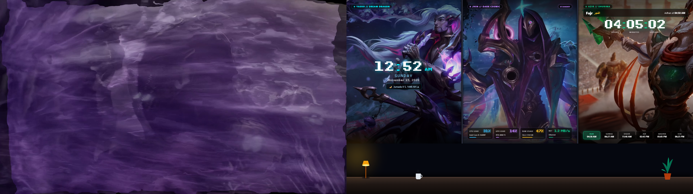

# Dual-Screen Live Wallpaper: Iron Man & League Holo-Triptych

[](https://github.com/cinitix/sucrose)
[](https://microsoft.com/windows)
[-purple.svg)](#)
[-brightgreen.svg)](#)
[](LICENSE)

An atmospheric, high-performance dual-screen live wallpaper designed for **[Sucrose Wallpaper Engine](https://github.com/cinitix/sucrose)** (Windows 10/11). Spans seamlessly across two monitors (3840×1080) combining an ultra-smooth 60 FPS slow-motion Iron Man cosmic shield loop on the left with an interactive, real-time League of Legends cyberpunk holo-triptych on the right.

---

## 📸 Preview



---

## ✨ Features

### 🖥️ Display 1 (Left Monitor — 1920×1080): Iron Man 60 FPS Shield Loop
- **Cinematic 60 FPS Slow-Motion**: Sub-pixel optical flow interpolated loop of Iron Man deploying nanotech shields against cosmic power beam energy, featuring fluid turnaround easing and zero stutter.
- **Hardware-Accelerated VP9 WebM**: High-framerate 60 FPS smooth playback optimized for ultra-low GPU/CPU overhead.

---

### 🖥️ Display 2 (Right Monitor — 1920×1080): League Holo-Triptych
Divided into three panoramic floor-to-ceiling bay windows overlooking the city, anchored by a cozy living room loft interior with a warm desk lamp, steaming coffee mug, and succulent plant.

#### 1. Left Bay: Yasuo Dynamic Day/Night Cycle & Clock
- **24-Hour Cycle**:
  - ☀️ **Day (06:00 AM – 06:00 PM)**: *Truth Dragon Yasuo*
  - 🌙 **Night (06:00 PM – 06:00 AM)**: *Dream Dragon Yasuo*
- **12-Hour Pixel Clock**: Large digital typography with blinking second colons and pixelated AM/PM badge.
- **Dual Calendars**:
  - Gregorian date and weekday (`SATURDAY, November 14, 2026`).
  - Real-time Islamic Hijri date (`🌙 Jumada II 5, 1448 AH`).

#### 2. Center Bay: Dark Cosmic Jhin & Task Manager Telemetry
- **Unobstructed Champion Visual**: Jhin’s celestial mask, glowing purple eye, and cosmic shoulder are 100% visible and unblocked in the center.
- **Real-Time Task Manager Telemetry**: Directly hooks into Windows Performance Counters via Sucrose IPC to match Task Manager:
  - **CPU Load**: Live % utilization + Auto-detected Processor name (e.g., `Intel Core i5-14400F`) + Cyan progress bar.
  - **GPU Load**: Live 3D engine % load + Auto-detected GPU name (e.g., `RTX 4060 Ti`) + Purple progress bar.
  - **RAM Usage**: Memory Load % + Exact Used / Total GB (e.g., `15.0 / 31.8 GB`) + Gold progress bar.
  - **Network Speed**: Live download speed in MB/s + Upload/Download breakdown on your active adapter + Emerald progress bar.
- **Live Status Indicator**: Automatically switches from `STANDBY` to `SUCROSE LIVE` when hardware hooks are active.

#### 3. Right Bay: Warring Kingdoms Azir & Alexandria Prayer Engine
- **Alexandria, Egypt Astronomical Timings**: Powered by the **Aladhan API** (Method 5 — *Egyptian General Authority of Survey*) with astronomical fallback.
- **Giant Countdown Ticker**: Real-time `HH : MM : SS` countdown to the next upcoming prayer matching the clock typography.
- **Next Prayer Hero Banner**: Displays the name in English & Arabic (`Isha / العشاء` or `Fajr / الفجر`) and scheduled Adhan time in 12-hour format.
- **6-Slot Prayer Timetable**: Highlights the current active prayer slot across the day:
  `Fajr` • `Sunrise` • `Dhuhr` • `Asr` • `Maghrib` • `Isha`

---

## 📥 Installation

### Prerequisites
1. **Windows 10 or 11** (64-bit).
2. **Sucrose Wallpaper Engine** installed and running.
   - Download from the [official Sucrose GitHub](https://github.com/cinitix/sucrose) or Microsoft Store.

---

### Method 1: One-Click Package Install (Recommended)
1. Download **`Dual_Screen_Sentry_League_Theme.sucrose`** from the [Releases](../../releases) tab (or root of this repo).
2. Open **Sucrose Wallpaper Engine**.
3. Click the **`+` (Add Wallpaper)** icon in the top-right corner.
4. Select the downloaded `.sucrose` file.
5. Sucrose will automatically unpack and add the wallpaper to your library.
6. Click the wallpaper card to apply it!

---

### Method 2: Manual Folder Install
1. Clone or download this repository.
2. Press `Win + R`, type `%AppData%\Sucrose\Library`, and hit **Enter**.
3. Copy the **`Dual_Screen_Sentry_League_Theme`** folder directly into the `Library` folder.
4. Restart or open Sucrose Wallpaper Engine.
5. The theme will appear in your installed wallpapers list.

---

## ⚙️ Multi-Monitor Setup (Dual Displays)

To have Iron Man appear on your Left monitor and the League Triptych appear on your Right monitor:
1. Open **Sucrose Wallpaper Engine**.
2. Go to **Settings** (Gear icon) -> **Display / Screen Layout**.
3. Under **Wallpaper Placement**, select **Span** (or select your multi-monitor group).
4. Apply the wallpaper. It will automatically span across both 1080p monitors (3840×1080 total resolution).

---

## 🛠️ Customization

### Changing the Prayer Location
By default, prayer times are calculated for **Alexandria, Egypt**. To change to your city:
1. Open `Dual_Screen_Sentry_League_Theme/league/index.html` in any text editor.
2. Locate line 620:
   ```javascript
   const res = await fetch('https://api.aladhan.com/v1/timings?latitude=31.2001&longitude=29.9187&method=5');
   ```
3. Replace the `latitude`, `longitude`, and `method` with your local coordinates (e.g., Cairo, Mecca, London, New York).
4. Save the file and refresh the wallpaper.

---

## 📂 Repository Structure

```text
├── assets/
│   └── preview.png                           # Dual-screen full 3840x1080 preview
├── Dual_Screen_Sentry_League_Theme/          # Core theme directory
│   ├── index.html                            # Dual-screen wrapper & IPC forwarder
│   ├── main.webm                             # Iron Man 60 FPS VP9 seamless loop (Display 1)
│   ├── main.mp4                              # Iron Man 60 FPS fallback
│   ├── SucroseCompatible.json                # Sucrose telemetry hook definitions
│   ├── SucroseInfo.json                      # Wallpaper metadata & authorship
│   ├── SucroseProperties.json                # Sucrose property bindings
│   ├── thumbnail.jpg                         # Library card thumbnail
│   ├── preview.gif                           # Animated UI preview
│   └── league/                               # League Holo-Triptych (Display 2)
│       ├── index.html                        # League UI, Clock, Telemetry, Prayer
│       ├── fonts/                            # Pixeloid Sans fonts
│       └── videos/                           # Seamless WebM (VP9) character loops
│           ├── DD_Yasuo_Seamless_Loop.webm   # Night cycle Yasuo
│           ├── TD_Yasuo_Seamless_Loop.webm   # Day cycle Yasuo
│           ├── DS_Jhin_Seamless_Loop.webm    # Hardware telemetry Jhin
│           └── WK_Azir_Seamless_Loop.webm    # Prayer times Azir
├── Dual_Screen_Sentry_League_Theme.sucrose   # Ready-to-import one-click package
└── README.md                                 # Documentation & guide
```

---

## 📜 Credits & License

- **Theme Development**: Created by [Mazen Shams](https://github.com/MazenShams).
- **Engine**: Powered by [Sucrose Wallpaper Engine](https://github.com/cinitix/sucrose).
- **Champions**: League of Legends assets © [Riot Games](https://www.riotgames.com/).
- **Iron Man**: Character © [Marvel](https://www.marvel.com/).
- **License**: Released under the [MIT License](LICENSE).
